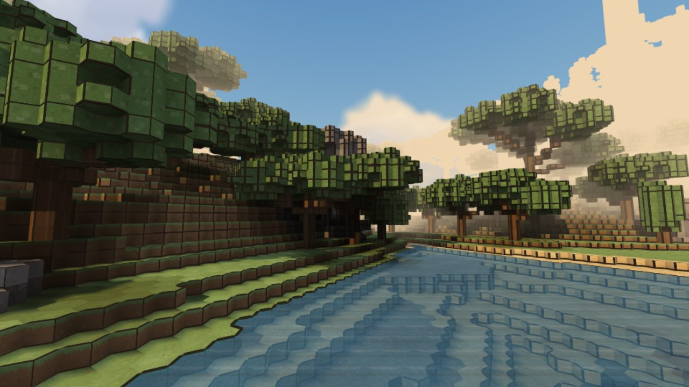
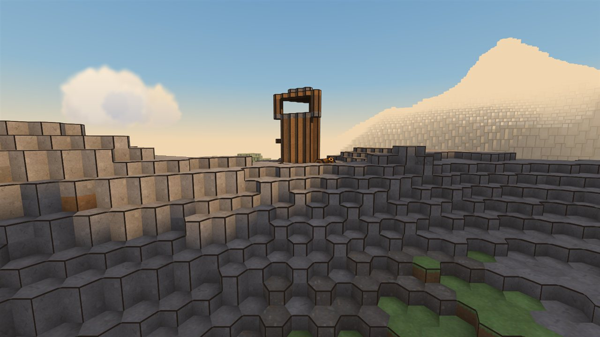
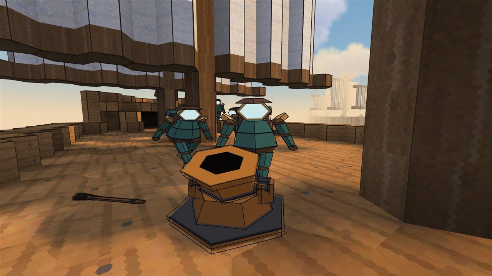
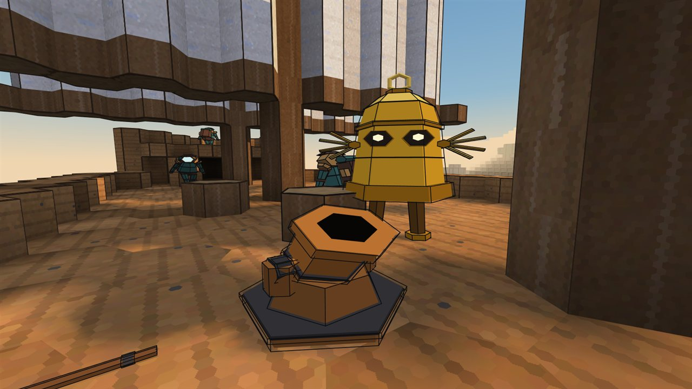
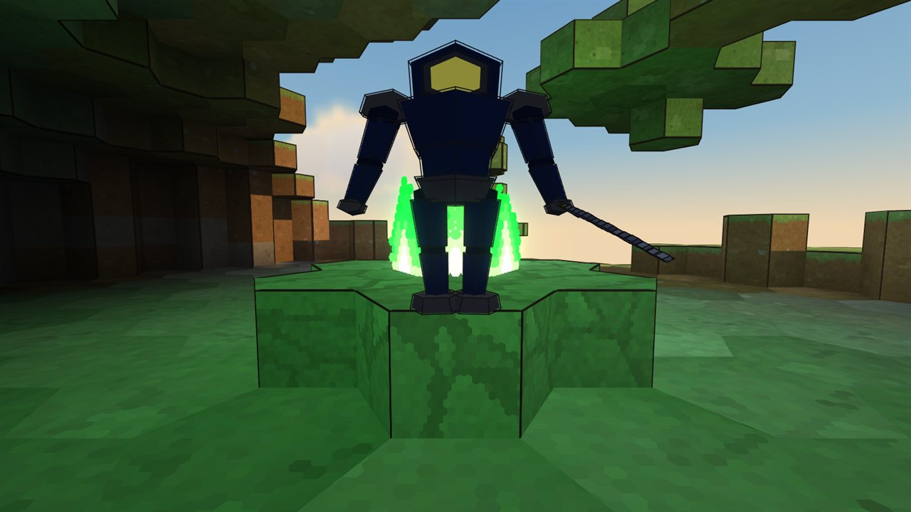
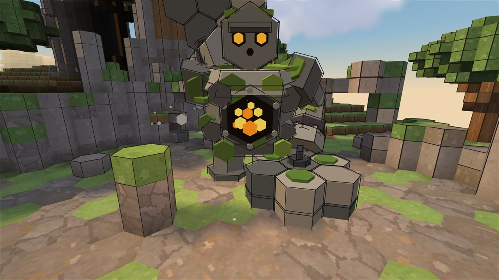
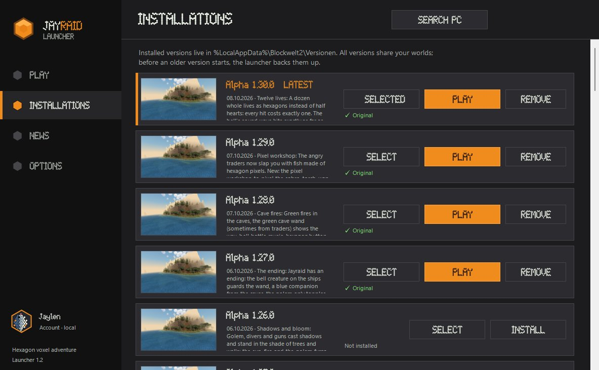

  

<h3 align="center">A hexagon voxel adventure</h3>

  Islands of hexagon pillars, trader ships on the horizon and diver camps up in the hills. 
  Build what you like, or follow the story to the golem in the castle ruin.

  
  

  
  
  
  

---

## The game

Jayraid is a sandbox first. Every world comes from a seed, is built from hexagon pillars and doesn't end.
If you want more than building, there is a story with two bosses and an actual ending.

<table>
  <tr>
    <td width="50%" valign="top"> <b>Blood moon</b> Some nights the moon turns red. Then the divers come for your base, and they bring field cannons. Whatever you built during the day had better hold.</td>
    <td width="50%" valign="top"> <b>Three ways to play</b> Sandbox if you just want to build. Adventure if you want the story. Challenge if twelve lives sound like too many: you get four.</td>
  </tr>
  <tr>
    <td valign="top"> <b>Traders and divers</b> The traders sail between the islands and trade with you. The divers hold the camps and watchtowers. Their ships and towers shoot at each other, with or without you.</td>
    <td valign="top"> <b>The bell</b> Every trader ship carries one, and it guards the golden wand. Hit it and it rings. The sound hurts. Take the wand and the traders won't forgive you.</td>
  </tr>
  <tr>
    <td valign="top"> <b>Down in the caves</b> Green fires burn deep in the mountains, guarded by rotten divers. Now and then one gets back up blue and follows you. Give it a sabre.</td>
    <td valign="top"> <b>The golem</b> Chained in an old castle ruin. Walk quietly and it sleeps. The sabre knocks it down, only the golden wand finishes it. Behind it waits the ending.</td>
  </tr>
</table>

## What's new

The latest updates, all in the launcher now:

- **Alpha 1.52.0 · The deep.** The world reaches down to Y -99, with four levels of dark caves and bedrock at the very bottom. Your existing worlds get the deep too.
- **Alpha 1.51.0 · Rain and branches.** Rain makes grass grow back on bare dirt, it rains half as hard under leaves, and branches show bark instead of tree rings.
- **Alpha 1.50.0 · Third person.** Press F2 to see yourself from behind as a diver who walks, looks around and swings the sabre.
- **Alpha 1.49.0 · Climate.** Height decides the colours: yellow green grass near the sea, deep green higher up, then snow. Shallow water glows turquoise, the deep sea turns dark blue.
- **Alpha 1.47.0 · Your own block colours.** Paint the textures of all blocks yourself and the game loads them right away.
- **Alpha 1.46.0 · A new start menu.** A bar with the title, a small animated scene and the news, and a large panel for your worlds.
- **Alpha 1.44.0 · The fallen sabre.** A giant sabre stuck in a crater, an altar, and a necromancer boss with two phases.
- **Alpha 1.42.0 · Sky and distant view.** Spectacular sunrises and sunsets, a milky way and shooting stars.

Every change: [CHANGELOG.md](CHANGELOG.md).

## Join the closed alpha

Jayraid is in a **closed alpha with 50 tester places**. The **beta starts on 28 October 2026 at 21:00 CET**. Testers get every version first and tell me what works and what doesn't.

1. Open the [website](https://pacointeractive.github.io/Jayraid/) and click **CLAIM A PLACE**. Your browser saves your personal code and `Jayraid-Launcher.zip`.
2. Install the free [.NET 8 Desktop Runtime](https://dotnet.microsoft.com/download/dotnet/8.0) (x64) once and unpack the launcher into a folder of its own.
3. Start `Jayraid-Launcher.exe`. If Windows warns you: **More info**, then **Run anyway**. Type in your code or drop the code file onto the window.
4. **INSTALL**, then **PLAY**. New versions show up as a big **UPDATE** button, and the launcher updates itself the same way.

On Mac, Linux or a phone, or if all places are gone: play the [browser preview on itch.io](https://paco-interactive.itch.io/jayraid), one island, no download.
Questions? Ask **Bubbles**, the little diver in the corner of the website.

  

## Only from here

Every version is listed in a **digitally signed** version list (`update/blockwelt-versionen.json` + `.sig`, RSA 3072).
Before every start the launcher checks the signature and every single file, and refuses anything that was changed or forged.
So only download Jayraid from this page.

## What's in this repository

| | |
|---|---|
| `update/` | Signed version list, encrypted game packages, tester list and the launcher. Read by the launcher. |
| `index.html`, `changelog.html`, `assets/`, `images/` | The website |
| [`CHANGELOG.md`](CHANGELOG.md) | Every change since Alpha 1.0.0, also [as a page](https://pacointeractive.github.io/Jayraid/changelog.html) |
| [`bubbles-faq.md`](bubbles-faq.md) | What Bubbles knows besides the game |
| `tools/` | Bubbles' optional worker and the format for game knowledge |

---

  Made by <b>Tixx</b> · Paco Interactive · © 2026 All rights reserved · <a href="LICENSE">License</a>

